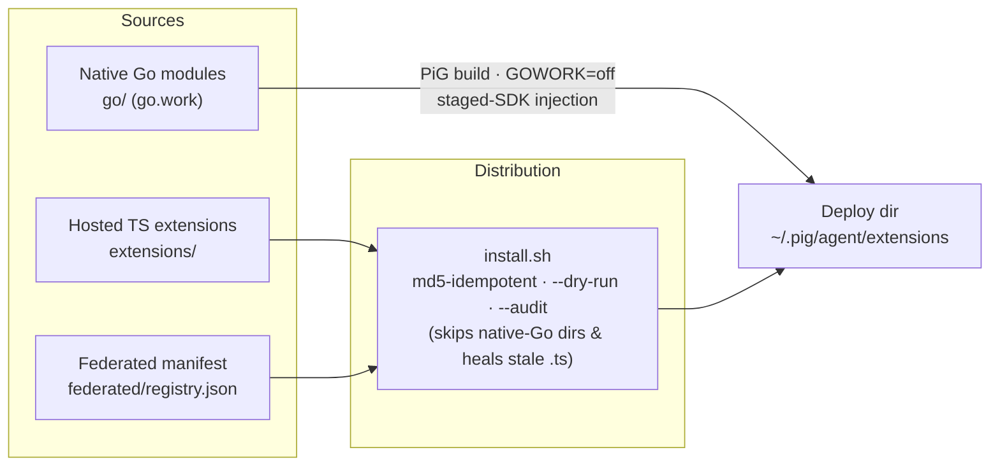

<div align="center">

<picture>
  <source media="(prefers-color-scheme: dark)" srcset="assets/logo-dark.svg">
  <source media="(prefers-color-scheme: light)" srcset="assets/logo-light.svg">
  
</picture>

# pi-extensions

**Battle-tested extensions for Pi & PiG coding agents — auto-continue, terminal-safe Markdown rendering, context compression, local classifier gates, and safety guards in native Go & TypeScript.**

<p>
  
  
  
  
</p>

[Extensions](#extensions-at-a-glance) · [Quick Start](#quick-start) · [Go Modules](#1-use-a-native-go-module-pig) · [Distribution](#2-federated-distribution-installsh)

**English** · [简体中文](README.zh-CN.md)

</div>

---

## Extensions at a Glance

This repo carries two stacks side by side: **native Go modules** under `go/` (PiG-ready) and **TypeScript extensions** under `extensions/` plus the federated manifest. Not every extension exists in both stacks — `magpie-image` is TS-only, `herdr-agent-state` is an external TS file this repo only audits, and `pi-vcc`, `rpiv-ask-user-question` & friends are Go-only ports. Pick the runtime your agent uses.

### Hosted (authoritative source lives in this repo)

| Extension | Stack | What it fixes |
|---|---|---|
| **auto-continue** | Go + TS | Transient provider / relay / network failure or a premature `finish_reason=stop`? It quietly tells the model "keep going" — never retries auth, quota, overflow, or user aborts. |
| **no-tables** | Go + TS | Terminal that mangles Markdown tables? Tables auto-convert to clean bullet lists, plus terminal-safe rewrites of fragile formatting. |
| **ctx-orchestrate** | Go + TS | Concurrent context retrieval: a combined `ctx_search_digest` tool plus codemode output governance hooks. |
| **jev-gate** | Go + TS | Local **System One classifier** (not an LLM) gating and audit — fast, deterministic checks before tool calls go out. Ships a `jev-mcp` companion module. |
| **exclude-tools-guard** | Go + TS | Safety guardrail that keeps excluded tools truly excluded — model can't sneak around the tool filter. |
| **magpie-image** | TS | Registers the local magpie gateway as an image provider so `models.generateImages()` works — no OpenRouter credentials needed. |

### Federated (source lives in the upstream repo, cascaded at install)

| Extension | Stack | What it fixes |
|---|---|---|
| **codegraph-go** | Go (in-repo) + TS (upstream) | stdio bridge that forwards the `codegraph` tool to an external `codegraph-go` index server — workdir authorization, lazy spawn, output sanitization. |
| **ctxmode** | Go (in-repo) + TS (upstream) | stdio bridge to the `ctxmode` binary, registering seven native tools (`ctx_run`, `ctx_fs`, `ctx_git`, `ctx_kb`, `ctx_bg`, `ctx_stats`, `ctx_report`) for context virtualization. |
| **pi-cache-stats** | TS (upstream) | Prompt-cache observability: per-run and per-session hit rates in a TUI footer, plus a `/cache-stats` command. Read-only — never rewrites your prompts. `go/cache-stats` below is this repo's native Go port of the same extension. |

### External (read-only, managed out-of-band)

| Extension | Stack | Note |
|---|---|---|
| **herdr-agent-state** | TS | Owned by the `herdr` binary; this repo only audits it read-only and **never writes it**. |
| **moshi-hooks** | TS | `moshi-hooks.ts` is generated by the external `moshi-hook` tool (see its `Auto-generated` header) serving the moshi daemon; this repo only audits it read-only and **never writes it**. Distinct from the retired `go/moshi-hooks` port. |

### PiG-native & community ports (Go modules, no TS counterpart)

| Extension | What it fixes |
|---|---|
| **pi-vcc** | Algorithmic conversation compression — structured summaries drive `session_before_compact`, with `vcc_recall` to retrieve pre- and post-compaction content. |
| **rpiv-ask-user-question** | Structured multiple-choice questions: the model asks, you answer 1–4 questions (2–4 options each) with custom input, preview, and multi-select support. |
| **cache-stats** | Prompt-cache hit-rate footer & diagnostics for PiG — the native Go port of the federated **pi-cache-stats** above. |
| **pi-my-compact-ui** | Compact conversation UI — folds streaming tool calls & thinking into collapsible groups with tree rails. |
| **pi-emphasis** | Scannable replies: renders `[[Done]]`/`[[Failed]]`-style status pills, icons, and colored markup. Rendering only — zero cost. |
| **pi-env** | Injects `env` settings into the process environment, with `$VAR` interpolation — and scrubs them back out of LLM context so secrets don't leak. |
| **pi-tinyfish** | Web search & fetch via the TinyFish API, pure Go `net/http` — no Node SDK. |
| **verifier-expect-fail** | Standalone CLI assertion tool with zero third-party dependencies (not a PiG extension): mechanical 4-condition output assertion for expect-fail regression probes. |

Retired components (`herdsman`, `moshi-hooks`, `pi-context-pruning`) keep their sources in `go/` for reference but no longer build or deploy by default. `go/pigsdk` mirrors the staged PiG SDK; `go/pigsdk-regress` holds its regression tests.

> **Note on deployment reality**: the real PiG extension dir `~/.pig/agent/extensions` currently loads **14 entries** — 13 native Go module dirs (each a `go.mod` unit: `auto-continue` is *not* deployed) plus the external `moshi-hooks.ts`. `federated/registry.json` now registers all of them: the 13 native dirs under `category="native"` (keyed by `destName`) and `moshi-hooks` under `category="external"`, so `--audit`'s unregistered diff-set is empty. `auto-continue` is registered-but-not-deployed (source exists, intent unverified) and `magpie-image` is registered-but-not-deployed by design.

## Quick Start

### 1. Use a Native Go Module (PiG)

Each extension module under `go/` is an independent module that depends on `github.com/MichaelKinsy/PiG/extensions/sdk v0.0.0` — a staged pseudo-version with no remote resolution, so a plain `go get` / `go build` cannot fetch it. Load native Go extensions through the workspace or PiG instead:

- **Local development** — work inside this repo: `go/go.work` resolves the SDK to the `go/pigsdk` mirror, so `go build` / `go vet` / `go test` work as usual.
- **PiG runtime** — point PiG at the component directory (the dir holding `go.mod`); PiG builds the extension with `GOWORK=off` and injects the staged SDK at build time.

For module architecture, the SDK resolution mechanism (`go.work` + staged SDK injection), and per-component docs, see **[go/README.md](go/README.md)**.

### 2. Federated Distribution (`install.sh`)

One script installs, dry-runs, and audits the whole extension set:

```bash
./install.sh --list              # what exists, where it goes, current status
./install.sh --dry-run <name>    # rehearse — writes nothing
./install.sh <name...>           # idempotent md5-checked install
./install.sh --audit             # read-only audit of the deploy dir (md5/drift/unregistered)
```

> [!TIP]
> Most extensions ship their own README and test suite in their subdirectory (`go/<name>/`, `extensions/<name>/`) — check there for flags, hooks, and edge cases.

## Architecture



## More Details

<details>
<summary><b>Repository Layout</b></summary>

```
go/                    # Native Go workspace: go.work lists 22 modules — the root module,
                       # 15 non-retired component modules, 3 retired ones kept for reference
                       # (herdsman, moshi-hooks, pi-context-pruning), the jev-mcp command
                       # module (jev-gate/cmd/jev-mcp), plus pigsdk & pigsdk-regress
  go/<name>/           # Each extension component: own go.mod, extension.go factory, tests
  go/pigsdk/           # Local mirror of the staged PiG SDK (md5-checked)
  go/pigsdk-regress/   # SDK regression tests driven through exported APIs
  go/examples/hello/   # Minimal PiG extension for smoke tests — standalone module, not in go.work
extensions/<name>/     # Hosted TS extensions — authoritative source, byte-synced on install
federated/registry.json# Single source of truth: 10 managed TS entries + 14 real
                       # load entries (13 native Go dirs + 1 external moshi-hooks.ts)
install.sh             # Unified install / dry-run / audit entry
tests/install.test.sh  # Regression tests for install.sh
archive/               # Archived historical bridges (not installed)
VERSIONING.md          # SemVer + multi-module tag policy
```

</details>

<details>
<summary><b>Federated Registry &amp; Audit Modes</b></summary>

Three managed TS categories plus the `native`/`external` load-entry registrations, one manifest (`federated/registry.json`):

- **hosted** — source lives here; `install.sh` copies it byte-for-byte (md5-idempotent, `unchanged` if identical).
- **federated** — source lives in its upstream repo; `install.sh` cascades into that repo's own `install.sh`.
- **external** — `herdr-agent-state.ts` (herdr binary) and `moshi-hooks.ts` (external moshi-hook tool) are managed out-of-band; audited read-only, **never written** by anything in this repo.
- **native** — the 14 PiG-native Go modules (13 deployed dirs + `auto-continue-go` registered-but-absent) pig loads via `<destDir>/<destName>/go.mod`; `install.sh` never installs TS for these, it only audits their `go.mod` presence.

`--audit` does a read-only sweep: md5 & permission checks on all registered entries, a diff-set scan for unregistered files in the deploy dir, `NATIVE`/`DRIFT` status when a native Go extension has taken over, and a `WARN` summary — exit code stays `0`.

</details>

<details>
<summary><b>Local Verification &amp; Versioning</b></summary>

- **`make check`** — the one gate: `bash -n` + `tests/install.test.sh`, then `make -C go check` (gofmt · sdk-check · vet · build · test) across the root module, the 15 non-retired components, jev-mcp, and pigsdk-regress — retired ones (`herdsman`, `moshi-hooks`, `pi-context-pruning`) stay in `go.work` but are excluded; `pigsdk` is validated by `sdk-check` instead of built.
- **`bash install.sh --audit`** — read-only audit of the deploy directory; not part of the source gate.
- **Versioning** — SemVer per Go module with `<subdir>/vX.Y.Z` tags and per-module `CHANGELOG.md`. See **[VERSIONING.md](VERSIONING.md)**.
- Contributing rules live in **[AGENTS.md](AGENTS.md)** — read it before touching anything.

</details>

## License

Per-module. MIT where a `LICENSE` exists — `go/pi-emphasis`, `go/pigsdk` — except `go/pigsdk/json` (vendored Go `encoding/json`), which is BSD-3-Clause. Each module's or vendored tree's own `LICENSE` file governs. Per-extension provenance and upstream notices live in each extension's own README.
