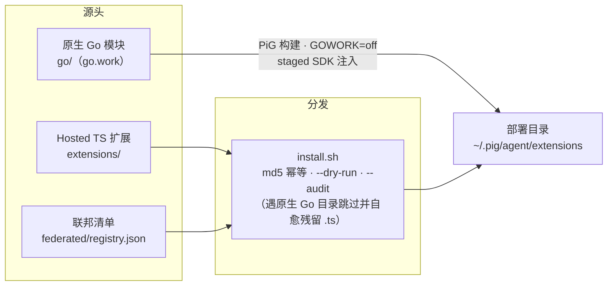

<div align="center">

<picture>
  <source media="(prefers-color-scheme: dark)" srcset="assets/logo-dark.svg">
  <source media="(prefers-color-scheme: light)" srcset="assets/logo-light.svg">
  
</picture>

# pi-extensions

**面向 Pi / PiG 编程 Agent 的实战扩展工具箱——涵盖断连自动续跑、终端表格防炸渲染、上下文压缩回溯、本地分类器门禁与安全护栏，提供原生 Go 模块与 TS 双栈支持。**

<p>
  
  
  
  
</p>

[核心扩展](#核心扩展速查表) · [快速开始](#快速开始) · [Go 模块](#1-使用原生-go-模块pig) · [联邦分发](#2-联邦分发installsh)

[English](README.md) · **简体中文**

</div>

---

## 核心扩展速查表

本仓包含两套栈：`go/` 下的**原生 Go 模块**（PiG 就绪）与 `extensions/` 下加联邦清单托管的 **TypeScript 扩展**。并非每个扩展都有双栈实现——`magpie-image` 仅 TS，`herdr-agent-state` 是本仓只读巡检的外部 TS 文件，`pi-vcc`、`rpiv-ask-user-question` 等是仅 Go 的移植。按你的 Agent 运行时选用对应栈。

### Hosted 内生（权威源在本仓）

| 扩展 | 栈 | 解决什么痛点 |
|---|---|---|
| **auto-continue** | Go + TS | provider/中转/网络的瞬时失败，或上游提前 `finish_reason=stop` 导致任务没说完——它悄悄给模型发一条「继续」；认证、配额、上下文溢出与用户中止绝不重试。 |
| **no-tables** | Go + TS | 终端渲染不了 Markdown 表格就乱成一锅粥？自动把表格转成清晰的 bullet 列表，顺带重写其它易炸的脆弱格式。 |
| **ctx-orchestrate** | Go + TS | 并发上下文检索编排：合并版 `ctx_search_digest` 组合工具 + codemode 回传治理钩子。 |
| **jev-gate** | Go + TS | 本地 **System One 分类器**（非 LLM）门禁与巡检——工具调用出门前先过快速、确定性的检查。附带 `jev-mcp` 伴生模块。 |
| **exclude-tools-guard** | Go + TS | 安全护栏：被排除的工具真正排除，模型无法绕过工具过滤器偷跑。 |
| **magpie-image** | TS | 把本机 magpie 网关注册为出图 provider，`models.generateImages()` 开箱可用——不需要任何 OpenRouter 凭据。 |

### Federated 外生（源在宿主仓，安装时级联）

| 扩展 | 栈 | 解决什么痛点 |
|---|---|---|
| **codegraph-go** | Go（本仓）+ TS（上游） | stdio 桥：把 `codegraph` 工具转发给外部 `codegraph-go` 索引服务——工作目录授权、按需启动、输出清洗。 |
| **ctxmode** | Go（本仓）+ TS（上游） | stdio 桥接 `ctxmode` 二进制，注册 `ctx_run`、`ctx_fs`、`ctx_git`、`ctx_kb`、`ctx_bg`、`ctx_stats`、`ctx_report` 七个原生工具，做上下文虚拟化。 |
| **pi-cache-stats** | TS（上游） | Prompt 缓存可观测：当前 run 与全会话命中率实时 TUI 页脚 + `/cache-stats` 命令。只读观测，绝不动你的 prompt。下方 `go/cache-stats` 是同一扩展在本仓的原生 Go 移植。 |

### External 外部（只读，带外托管）

| 扩展 | 栈 | 说明 |
|---|---|---|
| **herdr-agent-state** | TS | 由 `herdr` 二进制托管；本仓只对其做只读巡检，**绝不写它**。 |

### PiG 原生与社区移植（Go 模块，无 TS 对应）

| 扩展 | 解决什么痛点 |
|---|---|
| **pi-vcc** | 算法式对话压缩——结构化摘要驱动 `session_before_compact`，`vcc_recall` 可回溯压缩前后的内容。 |
| **rpiv-ask-user-question** | 结构化多选提问：模型提问，你需回答 1–4 个问题（每题 2–4 个选项），支持自定义输入、并排预览与多选。 |
| **cache-stats** | PiG 的 Prompt 缓存命中率页脚与诊断——上文 federated **pi-cache-stats** 的原生 Go 移植。 |
| **pi-my-compact-ui** | 紧凑对话 UI——把流式的工具调用与思考过程折叠成可收起的工具组（树形 rail）。 |
| **pi-emphasis** | 可扫读的回复：把 `[[Done]]`/`[[Failed]]` 状态胶囊、图标与标记渲染上色。只改绘制，零成本。 |
| **pi-env** | 把 settings 里的 `env` 注入进程环境变量（支持 `$VAR` 插值），并在进入 LLM 上下文前剔除，防敏感信息泄漏。 |
| **pi-tinyfish** | TinyFish 网页搜索与抓取，纯 Go `net/http`——不依赖 Node SDK。 |
| **verifier-expect-fail** | 零第三方依赖的独立 CLI 断言工具（非 PiG 扩展）：机械四条件输出断言，专用于预期失败的回归探针。 |

已退役组件（`herdsman`、`moshi-hooks`、`pi-context-pruning`）源码保留在 `go/` 中备查，但默认不再参与构建与部署。`go/pigsdk` 是 staged PiG SDK 的仓内镜像；`go/pigsdk-regress` 存放其回归测试。

## 快速开始

### 1. 使用原生 Go 模块（PiG）

`go/` 下每个扩展模块都是独立模块，依赖 `github.com/MichaelKinsy/PiG/extensions/sdk v0.0.0`——这是远端解析不到的 staged 伪版本，裸 `go get` / `go build` 拉不到它。原生 Go 扩展经工作区或 PiG 加载：

- **本地开发**——在本仓内工作：`go/go.work` 会把 SDK 解析到 `go/pigsdk` 仓内镜像，`go build` / `go vet` / `go test` 照常可用。
- **PiG 运行时**——把 PiG 指向组件目录（含 `go.mod` 的目录）；PiG 构建时显式 `GOWORK=off`，并在构建期注入 staged SDK。

模块架构、SDK 解析机制（`go.work` + staged SDK 注入）与各组件文档见 **[go/README.md](go/README.md)**。

### 2. 联邦分发（`install.sh`）

一个脚本完成整套扩展的安装、演练与巡检：

```bash
./install.sh --list              # 列出全部扩展：类别/来源/目标/当前状态
./install.sh --dry-run <name>    # 安全演练——不写任何文件
./install.sh <name...>           # md5 幂等安装
./install.sh --audit             # 部署目录只读巡检（md5/漂移/未登记条目）
```

> [!TIP]
> 大部分扩展在各自子目录（`go/<name>/`、`extensions/<name>/`）内提供独立 README 与测试用例——flag、钩子与边界条件请去那里查。

## 架构示意



## 进阶详情

<details>
<summary><b>目录结构</b></summary>

```
go/                    # 原生 Go 工作区：go.work 列 22 个 module——根 module、
                       # 15 个非退役组件 module、3 个退役备查 module（herdsman、
                       # moshi-hooks、pi-context-pruning）、jev-mcp 命令 module
                       # （jev-gate/cmd/jev-mcp）、pigsdk 与 pigsdk-regress
  go/<name>/           # 每个扩展组件：独立 go.mod、extension.go 工厂、测试
  go/pigsdk/           # staged PiG SDK 的仓内镜像（md5 校验）
  go/pigsdk-regress/   # 经导出 API 驱动的 SDK 回归测试
  go/examples/hello/   # 最小 PiG 扩展示例（冒烟用）——独立 module，不在 go.work 中
extensions/<name>/     # Hosted TS 扩展——唯一权威源，安装时逐字节同步
federated/registry.json# 唯一数据源：10 个扩展的类别与权威路径
install.sh             # 统一安装 / 演练 / 巡检入口
tests/install.test.sh  # install.sh 的回归测试
archive/               # 归档的历史桥接（不参与安装）
VERSIONING.md          # SemVer + 多模块 tag 规范
```

</details>

<details>
<summary><b>联邦分发与巡检模式</b></summary>

三个类别，一份清单（`federated/registry.json`）：

- **hosted（内生）**——源码在本仓；`install.sh` 逐字节同步（md5 幂等，一致则 `unchanged`）。
- **federated（外生）**——源码留在各宿主仓；`install.sh` 级联调用宿主仓自己的 `install.sh`。
- **external（外部）**——`herdr-agent-state.ts` 由 `herdr` 二进制托管；只读巡检，本仓任何东西都**绝不写它**。

`--audit` 做一次只读扫描：全部已登记条目的 md5 与权限检查、部署目录未登记条目差集、原生 Go 接管时的 `NATIVE`/`DRIFT` 状态标注，以及 `WARN` 汇总——退出码保持 `0`。

</details>

<details>
<summary><b>本地校验与多模块发版规范</b></summary>

- **`make check`**——唯一检查门禁：`bash -n` + `tests/install.test.sh`，然后 `make -C go check`（gofmt · sdk-check · vet · build · test）覆盖根 module、15 个非退役组件、jev-mcp 与 pigsdk-regress——退役组件（`herdsman`、`moshi-hooks`、`pi-context-pruning`）仍留在 `go.work` 但不参与；`pigsdk` 由 `sdk-check` 校验、不构建。
- **`bash install.sh --audit`**——部署目录只读巡检，不属于源码检查门禁。
- **发版**——各 Go 模块独立 SemVer，tag 形如 `<子目录>/vX.Y.Z`，各模块自带 `CHANGELOG.md`。详见 **[VERSIONING.md](VERSIONING.md)**。
- 贡献规则见 **[AGENTS.md](AGENTS.md)**——动手前必读。

</details>

## License

按模块定许可。带 `LICENSE` 处为 MIT（`go/pi-emphasis`、`go/pigsdk`），但 `go/pigsdk/json`（内嵌 Go `encoding/json`）为 BSD-3-Clause；一律以各模块/内嵌代码自带的 `LICENSE` 文件为准。各扩展的上游出处与声明见其各自 README。
